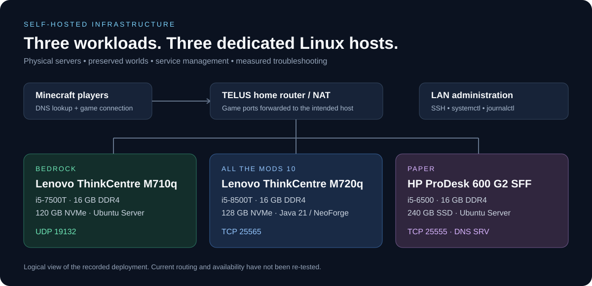
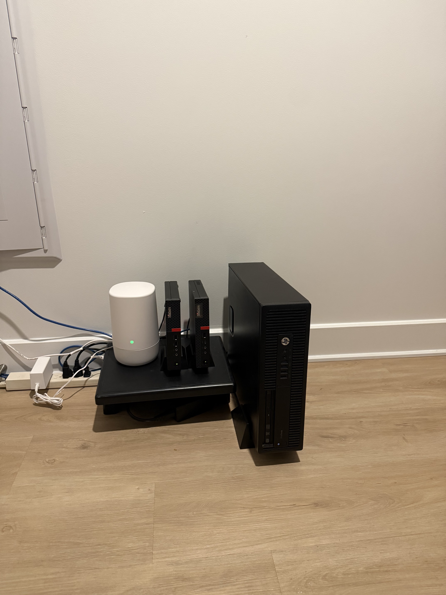
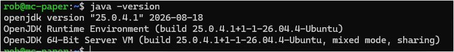
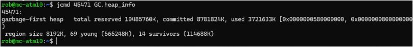

# Minecraft Server Infrastructure

**Three dedicated Ubuntu hosts. Two workload migrations. Real command output and troubleshooting evidence.**

A self-hosted environment running Bedrock Dedicated Server, All the Mods 10, and Paper on repurposed business PCs. This project follows the work from hardware selection and world transfers to Linux service management, DNS, storage allocation, and JVM diagnostics.

## Start here

| Walkthrough | What it demonstrates |
| --- | --- |
| [Bedrock migration](docs/bedrock-migration.md) | Preserve worlds and add-ons, validate the destination, expand LVM, check a recovery archive |
| [ATM10 deployment and diagnostics](docs/atm10-deployment.md) | Migrate a single-player save, manage NeoForge, inspect JVM memory, investigate startup and backup issues |
| [Paper: Windows to Ubuntu](docs/paper-migration.md) | Preserve a 23 GB server, prepare a Linux service identity, validate Java, logs, listener, and DNS |
| [Troubleshooting case studies](docs/troubleshooting.md) | Separate symptoms, evidence, decisions, and unresolved questions |
| [Screenshot evidence](screenshots/README.md) | Original Java, heap, and DNS captures with precise captions |
| [Administration commands](docs/command-reference.md) | Hardware inventory, service checks, logs, sockets, DNS, and Java diagnostics |

## The environment

**Physical deployment, identified by the owner:** white box — wireless router; left mini PC — Bedrock; middle mini PC — ATM10; HP desktop on the right — Paper. [Photo and hardware mapping](photos/README.md).

| Workload | Host | CPU | RAM | Storage | Recorded OS |
| --- | --- | --- | --- | --- | --- |
| [Bedrock](servers/bedrock/README.md) | Lenovo ThinkCentre M710q | i5-7500T, 4C/4T | 16 GB DDR4 | 120 GB NVMe | Ubuntu Server 24.04.4 LTS |
| [ATM10](servers/atm10/README.md) | Lenovo ThinkCentre M720q | i5-8500T, 6C/6T | 16 GB DDR4 | 128 GB WD SN520 NVMe | Ubuntu Server 26.04.1 LTS |
| [Paper](servers/paper/README.md) | HP ProDesk 600 G2 SFF | i5-6500 | 16 GB DDR4 | 240 GB SSD | Ubuntu Server 26.04.1 LTS |

These are physical hosts. Bedrock originally occupied the M720q, then moved to the M710q so the six-core machine could host the heavier ATM10 workload. Paper later moved from Windows to the HP. See [hardware evidence and chronology](docs/hardware-inventory.md).

## Engineering highlights

- **Workload placement:** moved the lighter Bedrock workload before repurposing the stronger machine for modded Java.
- **Data preservation:** transferred existing worlds, add-ons, plugins, datapacks, inventories, and progression rather than rebuilding from scratch.
- **Linux operations:** used systemd, journalctl, tmux, dedicated runtime directories, and service-state checks.
- **Storage troubleshooting:** distinguished installed disk capacity from allocated LVM root space.
- **Network diagnosis:** separated local listeners, firewall policy, NAT forwarding, A records, and a Minecraft SRV record for Paper's non-default TCP port.
- **Performance analysis:** checked actual JVM heap use before increasing memory allocation in response to exploration lag.

## Evidence, not just a parts list

### Paper runtime installed and verified

The original host capture confirms OpenJDK 25.0.4.1. The [Paper walkthrough](docs/paper-migration.md) connects runtime preparation to the migration and subsequent gameplay validation.

### ATM10 heap measured before tuning

The original idle sample shows approximately **3.55 GiB used**, **8.38 GiB committed**, and **10 GiB reserved**. A large Java process alone did not establish heap exhaustion. The [diagnostic case study](docs/atm10-deployment.md#4-investigate-the-exploration-slowdown) explains the decision and its limits.

The [gallery](screenshots/README.md) also includes the original Paper DNS SRV configuration screenshot.

## Operational boundaries

| Area | What the record establishes |
| --- | --- |
| Gameplay | Owner confirmed the three-server environment working after Paper migration |
| Bedrock migration | Destination service reported active and enabled; subsequent UDP listener check recorded |
| Bedrock recovery archive | Archive listing succeeded; this is not a full restore test |
| ATM10 backups | Backup service and troubleshooting recorded; final recurring-job success remains unverified |
| Paper backups | Automatic backups remained follow-up work in the reviewed messages |
| Monitoring | No deployed dashboard or sustained uptime claim |

This repository documents historical work recovered in November 2026. Commands are attributed to the setup workflow or labeled as reference sequences; they have not been rerun against the live hosts for this publication. Credentials, player data, world saves, raw logs, private addresses, and service secrets are excluded. The original DNS screenshot retains the public hostname.

## Further documentation

- [Network architecture](docs/architecture.md)
- [Operations and remaining work](docs/operations.md)
- [Evidence and documentation conventions](docs/evidence-method.md)
- Related project: [Enterprise Infrastructure Homelab](https://github.com/robcorbisiero/enterprise-infrastructure-homelab)
