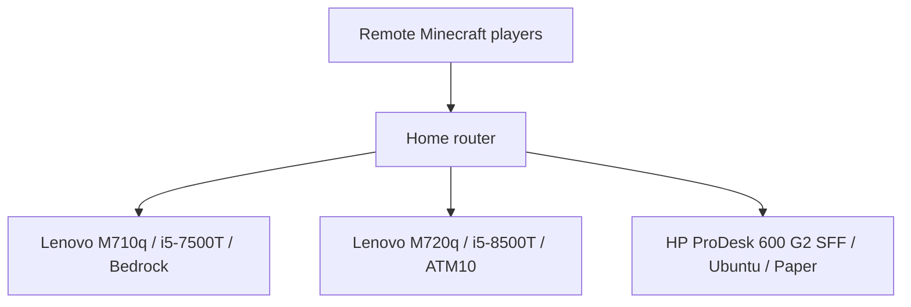

# Minecraft Server Infrastructure

Three dedicated physical Linux machines hosting Minecraft Bedrock Dedicated Server, All the Mods 10 (ATM10), and Paper. This project documents the environment and the migration of an existing Paper server from Windows to Ubuntu.

## Server inventory

| Workload | Hardware recorded during setup | Platform | Recorded outcome |
| --- | --- | --- | --- |
| [Bedrock](servers/bedrock/README.md) | Lenovo ThinkCentre M710q; i5-7500T; 16 GB DDR4; 120 GB NVMe | Ubuntu Server 24.04.4 LTS | Migrated from M720q |
| [ATM10](servers/atm10/README.md) | Lenovo ThinkCentre M720q; i5-8500T; 16 GB DDR4; 128 GB WD SN520 NVMe | Ubuntu Server 26.04.1 LTS | Repurposed from Bedrock; single-player world migrated |
| [Paper](servers/paper/README.md) | HP ProDesk 600 G2 SFF; i5-6500; 16 GB DDR4; 240 GB SSD | Ubuntu Server 26.04.1 LTS | Windows migration completed; owner confirmed gameplay working |

These are separate physical servers, rather than workloads assumed to run inside the separate Proxmox homelab.

## Architecture

Bedrock originally ran on the M720q. It moved to the M710q so the newer six-core M720q could host ATM10. Recorded application ports are Bedrock UDP 19132, ATM10 TCP 25565, and Paper TCP 25555; current router rules have not been inspected.

## Documentation

- [Architecture and network configuration](docs/architecture.md)
- [Paper migration from Windows to Linux](docs/paper-migration.md)
- [Operations and remaining work](docs/operations.md)
- [Hardware inventory and migration chronology](docs/hardware-inventory.md)
- Individual server notes: [Bedrock](servers/bedrock/README.md), [ATM10](servers/atm10/README.md), [Paper](servers/paper/README.md)

## Skills demonstrated

- Hosting three distinct Minecraft server environments on dedicated Linux hardware.
- Migrating an existing Windows Paper workload while retaining worlds and plugin data.
- Configuring Java server access through a non-default TCP port and Minecraft DNS SRV record.
- Validating a migration through application startup and player testing.
- Identifying storage cleanup, backup, and monitoring follow-up work.

## Documentation status

Updated November 3, 2026 using earlier setup messages, hardware assessments, migration confirmations, and original Paper terminal output. Specifications and OS versions describe the recorded setup; historical working status is not a live health check.

Earlier messages include ATM10 backup-service troubleshooting and a verified Bedrock recovery archive. Final automated backup schedules and off-host copies remain unverified; see the operations notes. Monitoring and restore-test completion are not established. World saves, player information, binaries, credentials, and live configuration files are excluded.

Related project: [Enterprise Infrastructure Homelab](https://github.com/robcorbisiero/enterprise-infrastructure-homelab).
