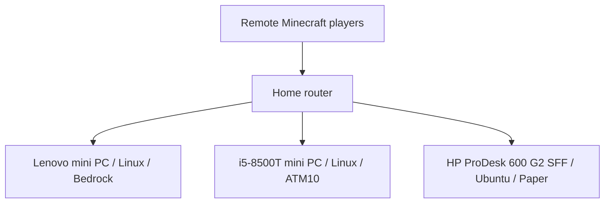

# Minecraft Server Infrastructure

Three dedicated physical Linux machines hosting Minecraft Bedrock Dedicated Server, All the Mods 10 (ATM10), and Paper. This project documents the environment and the migration of an existing Paper server from Windows to Ubuntu.

## Server inventory

| Workload | Hardware recorded during setup | Platform | Recorded outcome |
| --- | --- | --- | --- |
| [Bedrock](servers/bedrock/README.md) | Lenovo mini PC | Linux | Working alongside the other two servers |
| [ATM10](servers/atm10/README.md) | Mini PC with Intel Core i5-8500T | Linux | Working alongside the other two servers |
| [Paper](servers/paper/README.md) | HP ProDesk 600 G2 SFF | Ubuntu | Windows migration completed; owner confirmed gameplay working |

These are separate physical servers, rather than workloads assumed to run inside the separate Proxmox homelab.

## Architecture

The diagram shows the logical arrangement. Exact Bedrock and ATM10 forwarding rules were not available in the recovered setup notes.

## Documentation

- [Architecture and network configuration](docs/architecture.md)
- [Paper migration from Windows to Linux](docs/paper-migration.md)
- [Operations and remaining work](docs/operations.md)
- Individual server notes: [Bedrock](servers/bedrock/README.md), [ATM10](servers/atm10/README.md), [Paper](servers/paper/README.md)

## Skills demonstrated

- Hosting three distinct Minecraft server environments on dedicated Linux hardware.
- Migrating an existing Windows Paper workload while retaining worlds and plugin data.
- Configuring Java server access through a non-default TCP port and Minecraft DNS SRV record.
- Validating a migration through application startup and player testing.
- Identifying storage cleanup, backup, and monitoring follow-up work.

## Documentation status

Prepared November 3, 2026 from the recovered setup conversation and the owner's confirmation of the three server types. Historical working status is not a live health check. Exact RAM, storage, OS releases, service units, and installed versions require a fresh inventory before they can be documented as current.

Automated backups, restore tests, monitoring, and maintenance scripts are follow-up work; this repository does not claim they have been implemented. It contains documentation only. World saves, player information, binaries, credentials, and live configuration files are excluded.

Related project: [Enterprise Infrastructure Homelab](https://github.com/robcorbisiero/enterprise-infrastructure-homelab).
