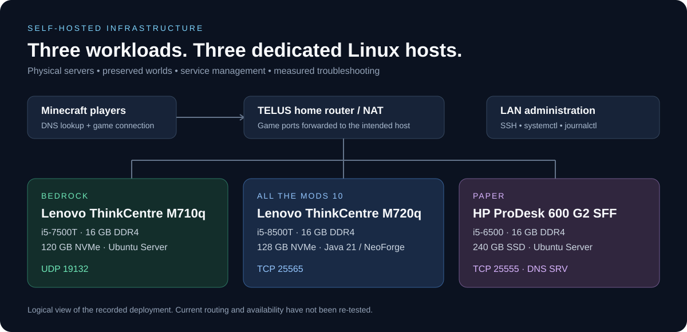

# Networking

Each Minecraft server has its own physical Ubuntu machine. I manage them over SSH on the LAN, with the home router handling the internet connection and port forwarding.



| Server | Host | Game port |
| --- | --- | --- |
| Bedrock | M710q / mc-bedrock | UDP 19132 |
| ATM10 | M720q / mc-atm10 | TCP 25565 |
| Paper | HP ProDesk / mc-paper | TCP 25555 |

## Paper DNS

I used a non-default port for Paper and set up a Minecraft SRV record so players could use the hostname without typing the port.

Using an example domain, the record looks like this:

```dns
_minecraft._tcp.paper.example.com. 1800 IN SRV 0 0 25555 paper.example.com.
```

The target also needs an A record pointing to the public IPv4 address, and the router needs to forward TCP 25555 to the Paper machine.

I checked the records with:

```bash
dig +short paper.example.com A
dig +short SRV _minecraft._tcp.paper.example.com
```

The [DNS screenshot](../screenshots/README.md#paper-dns-service-record) shows the record I configured.

## Firewall notes

During setup I checked LAN-only SSH rules and allowed Bedrock's UDP port. ATM10's TCP port was LAN-only at that stage. Those were different points in the setup, so I still need to add a current copy of the rules and router configuration here.

I keep private IP addresses and credentials out of the examples. The public hostname is visible in the original DNS screenshot.
