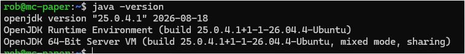

# Moving Paper from Windows to Ubuntu

## The move

I moved my Paper server from Windows to the HP ProDesk running Ubuntu. There was about 23 GB to transfer, including the worlds, plugins, datapacks, and configuration. I tested it after the move and everything was working.

## Files and Java



This was the Java version after installation: OpenJDK 25.0.4.1.

- Runtime directory: `/opt/minecraft/paper/`.
- Transfer staging directory: `/home/rob/paper-transfer/`.
- Runtime files included `paper.jar`, world folders, plugin data, configuration, libraries, and versions.
- The transfer also contained Windows startup artifacts and an older Paper JAR.

## Command walkthrough

### Check the HP

I checked the Ubuntu installation before transferring anything:

```bash
hostnamectl
free -h
lsblk -o NAME,SIZE,FSTYPE,MOUNTPOINTS
java -version
```

The HP was running Ubuntu 26.04.1 LTS, with 14 GiB usable RAM, 4 GiB swap, and a 223.6 GiB disk. Root initially had 100 GiB allocated. Java wasn't installed yet.

### Prepare the server directory

The directory and account setup in my migration plan was:

```bash
sudo useradd --system --home-dir /opt/minecraft/paper \
  --shell /usr/sbin/nologin minecraft
sudo mkdir -p /opt/minecraft/paper
sudo chown -R minecraft:minecraft /opt/minecraft/paper
```

This creates a separate `minecraft` account for the server. Check whether it already exists before repeating the account creation.

### Transfer the Windows server

My Windows folder was `C:\Users\Rob\Paper-Server`. The transfer plan was to stop Paper with `stop` in its console, then copy the whole folder to `/home/rob/paper-transfer/` on Ubuntu.

I needed all the Multiverse worlds, plugin configuration, datapacks, and player data to come across. I kept the Windows copy as a fallback and waited for the transfer to finish before moving on.

### Check the server and DNS

These are the service, port, and DNS checks together for reference:

```bash
systemctl status minecraft-paper --no-pager -l
sudo journalctl -u minecraft-paper -n 50 --no-pager
sudo ss -ltnp | grep 25555
dig +short paper.example.com A
dig +short SRV _minecraft._tcp.paper.example.com
```

Replace `paper.example.com` with your hostname. My SRV record points to port 25555; the [screenshot](../screenshots/README.md#paper-dns-service-record) shows the DNS setup.

I checked the logs and listener as well as DNS, then tested the actual game. Seeing the process running wasn't enough to call the move finished.

## Cleanup and follow-up

The transfer left Windows startup files, an older Paper JAR, logs, crash reports, and about 23 GB duplicated in the staging folder. I still need to confirm the cleanup. I'd keep a separate verified backup before deleting the staging copy.

View distance and simulation distance were both 14 during setup. Lowering them was an option to try if performance needed it; I haven't documented that change.


