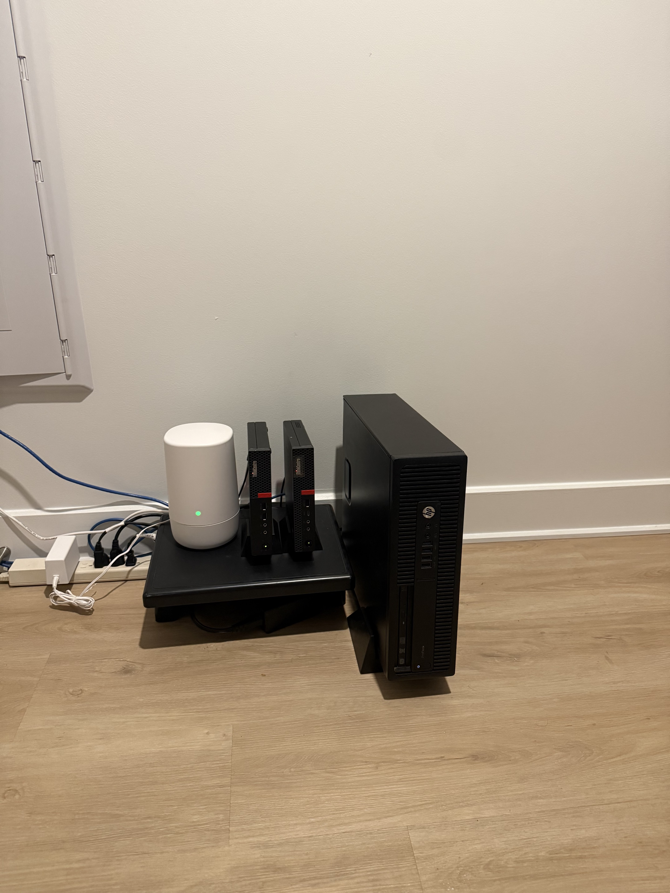

# Physical deployment

The owner supplied this photograph and identified the devices from left to right:

| Position | Device | Role |
| --- | --- | --- |
| White box | Wireless router | Home wireless router beside the server hosts |
| Left Lenovo mini PC | ThinkCentre M710q | Minecraft Bedrock Dedicated Server |
| Middle Lenovo mini PC | ThinkCentre M720q | All the Mods 10 / NeoForge |
| HP desktop on the right | ProDesk 600 G2 SFF | Paper Java server |

The photograph shows the physical arrangement of the dedicated hosts. Workload assignments are confirmed by the owner; CPU, memory, and storage specifications come from the [hardware inventory](../docs/hardware-inventory.md), rather than being inferred from the image. The photo does not establish cabling paths, firewall policy, uptime, or backup status.

The original supplied photograph is retained without generated labels or alterations.
