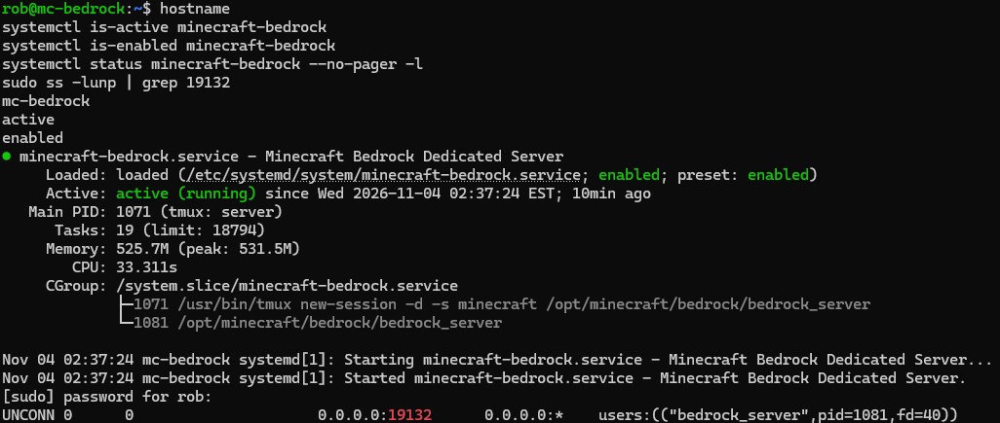
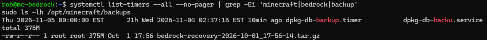
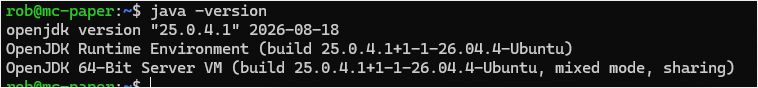
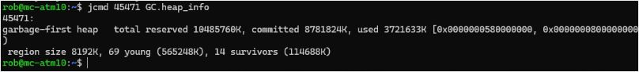
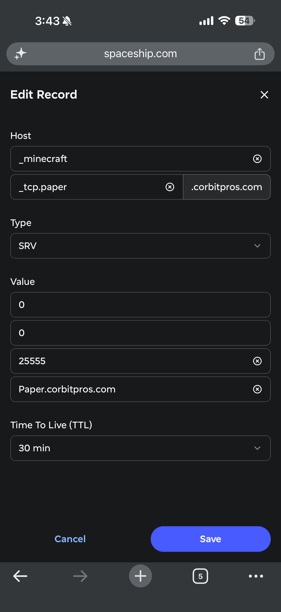

# Screenshots

A few captures from setting up and troubleshooting the servers.

## Bedrock: service and backup checks

November 4, 2026: `mc-bedrock` was running, enabled at boot, and listening on UDP 19132. This is a local service check; I haven't used it as proof of an external player connection.

The directory showed one 375 MB recovery archive from October 1. The timer listed is `dpkg-db-backup.timer`, not a Minecraft backup. No Minecraft timer appeared in this filtered list. Cron and other backup locations still need checking.

## Paper: installed Java runtime

I ran `java -version` on `mc-paper` after installing Java. It shows OpenJDK 25.0.4.1 and the Ubuntu build.

## ATM10: measured heap use

This is `jcmd 45471 GC.heap_info` on `mc-atm10`. The process ID was specific to that session.

The output shows 10,485,760 KiB reserved, 8,781,824 KiB committed, and 3,721,633 KiB used: roughly 10 GiB, 8.38 GiB, and 3.55 GiB respectively. Nobody was playing when I took this sample, so I still needed to check it during exploration.

## Paper: DNS service record

This is the SRV record I configured for Paper: `_minecraft._tcp.paper`, priority 0, weight 0, port 25555, and a 30-minute TTL. The public hostname is visible in the image.

I also checked DNS and tested the server afterward; the editor screenshot on its own only shows the configuration I entered.
