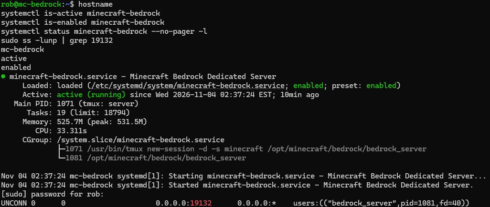
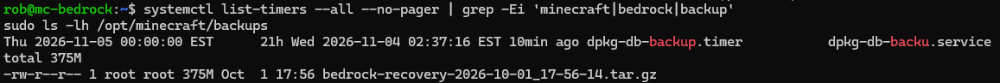
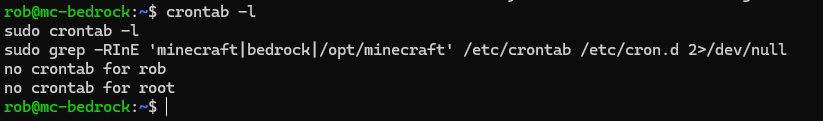
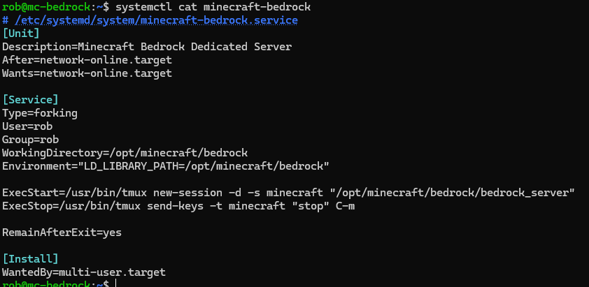

# Bedrock Dedicated Server

| Item | Setup |
| --- | --- |
| Machine | Lenovo ThinkCentre M710q |
| CPU | Intel Core i5-7500T, 4 cores / 4 threads |
| RAM | 16 GB DDR4 |
| Storage | 120 GB NVMe; terminal assessment reports 119.2 GiB |
| OS | Ubuntu Server 24.04.4 LTS |
| Hostname | `mc-bedrock` |
| Application port | UDP 19132 |
| Installation | `/opt/minecraft/bedrock/` |
| Service | `minecraft-bedrock` |

I moved Bedrock from the M720q to the M710q, including the worlds, behavior packs, resource packs, and configuration. I checked that the service was active and enabled, then expanded the root LVM volume.

The transferred add-ons included BOMD, Dynamic Lighting, and Better Backpacks. My earlier version notes list BDS 1.26.51.1, BOMD 1.5.1, and Dynamic Lighting 4.0; these may have changed since.

I checked a recovery archive with tar, restarted Bedrock, and confirmed the UDP 19132 listener. A full restore test and the final backup schedule are still on my list.

See [architecture](../../docs/architecture.md) and [operations](../../docs/operations.md).

Read the [full migration command walkthrough](../../docs/bedrock-migration.md).

## Service check — November 4, 2026

I checked `mc-bedrock`: the service was active, enabled at startup, and listening on UDP 19132. The status showed about 525.7 MB of memory use and a tmux session named `minecraft` launching `/opt/minecraft/bedrock/bedrock_server`.

The backup directory contained one 375 MB recovery archive dated October 1. The filtered timer list only showed `dpkg-db-backup.timer`, which backs up the package database. This check didn't find a Minecraft systemd timer. I checked cron next, as shown below.

### Cron and the service file

I checked cron next: neither `rob` nor `root` had a crontab, and the search in `/etc/crontab` and `/etc/cron.d` returned no Minecraft entries. Between this and the timer check, I haven't found an automatic Bedrock backup job in those locations.

The installed [minecraft-bedrock.service](minecraft-bedrock.service) runs as `rob`, starts a detached tmux session named `minecraft`, and sets `LD_LIBRARY_PATH` to the Bedrock directory. Its stop action sends `stop` followed by Enter to that session.

This is a copy of my current unit, including `Type=forking` and `RemainAfterExit=yes`. I still need to test that it waits for Bedrock to finish saving during shutdown and accurately reflects an unexpected server exit. The file alone doesn't establish either behavior.
